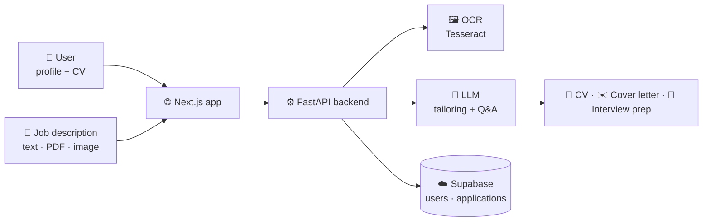

<!-- ApplyMate · README by Usama Shahid (fewgets) -->
<div align="center">


<p>
  
  
  
  
  
  
</p>

</div>

---
> 🚧 **Status: in active development.** The first module (job-description OCR) is in this repo; the
> rest of the pipeline below is the planned design. Follow along or reach out if you'd like to collaborate.

## 📌 Overview

Applying for jobs is repetitive: rewrite the CV, write a new cover letter, fill the same forms,
then prepare for interviews from scratch. **ApplyMate** is an AI assistant that automates this
whole journey:

1. 📄 **Understand the job:** read a job description from text, a PDF or even a **screenshot** (OCR).
2. ✍️ **Tailor your documents:** rewrite your CV and generate a matching cover letter with an LLM.
3. 📤 **Apply:** fill in and submit the application for you.
4. 🎤 **Prepare:** generate likely interview questions and practise with interactive Q&A cards.

---

## 🗺️ Development Status

| Module | Description | Status |
|---|---|:-:|
| 🖼️ **JD Extractor** | OCR that reads job descriptions from images (OpenCV + Tesseract) | ✅ Done |
| 🧾 **JD Parser** | Extract skills, requirements and keywords with NLP | 🔄 In progress |
| 📝 **Resume Tailor** | LLM rewrites the CV to match the job | 📋 Planned |
| ✉️ **Cover Letter Generator** | Personalised letter for each role | 📋 Planned |
| 📤 **Auto-Apply** | Form filling and submission | 📋 Planned |
| 🎤 **Interview Coach** | Mock questions and practice cards | 📋 Planned |
| 🌐 **Web App** | Next.js frontend with Supabase auth, on Vercel | 📋 Planned |

---

## 🏗️ Planned Architecture



---

## 🚀 Try the JD Extractor

```bash
git clone https://github.com/fewgets/ApplyMate.git
cd ApplyMate/backend

pip install opencv-python pytesseract
```

1. Install [Tesseract OCR](https://github.com/tesseract-ocr/tesseract). On Windows, set its path in `jdextract.py`.
2. Set `image_path` in `jdextract.py` to a screenshot of a job post.
3. Run:

```bash
python jdextract.py
```

The extracted job-description text is printed to the terminal.

---

## 🧰 Tech Stack

| Layer | Technology |
|---|---|
| OCR | OpenCV, Tesseract (`pytesseract`) |
| Backend *(planned)* | Python, FastAPI |
| AI *(planned)* | LLM APIs for rewriting, generation and Q&A |
| Frontend *(planned)* | Next.js, Tailwind CSS, shadcn/ui |
| Database *(planned)* | Supabase (PostgreSQL + Auth) |
| Hosting *(planned)* | Vercel |

---

## 🤝 Let's Work Together

<div align="center">

**Have an idea, a freelance project, or want to collaborate on something in AI?**
I'm always open to collaborations, freelance work and full-time opportunities.

<a href="mailto:shaikhusama541@gmail.com?subject=Collaboration%20-%20ApplyMate">
  
</a>
<a href="https://www.linkedin.com/in/-usamashahid/">
  
</a>
<a href="https://github.com/fewgets">
  
</a>

<br/><br/>

⭐ **If you like this project, please give it a star. It really helps!** ⭐

<br/>

<h3>"Spend your time preparing, not copy-pasting applications."</h3>


</div>
